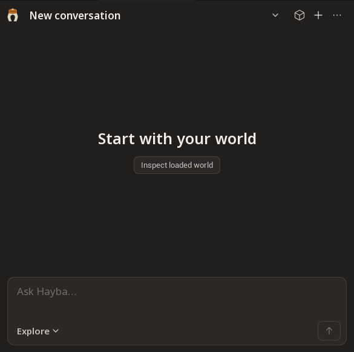

# Install Hayba 0.4.1 (Windows, Unreal Engine 5.9)

This guide takes you from nothing to an AI agent that can see and edit your
Unreal project. Every step is one action. Commands are for **PowerShell**:
copy the grey box, paste it into PowerShell, press Enter, and wait for it to
finish before going to the next step.

It takes about 30 to 60 minutes, most of it waiting for downloads and the
first build.

**What you end up with**

- The **Hayba MCP Toolkit** plugin inside your Unreal project. It lets an AI
  agent read and change the open editor, safely.
- The **Hayba MCP server** on your PC. Your AI app (for example Claude Code)
  talks to it, and it talks to the plugin.

> **Use a copy of your project the first time.** Hayba can change levels,
> Blueprints and assets. Try it on a scratch project or a backup copy first.

---

## What you need

| You need | Version | Why |
| --- | --- | --- |
| Windows | 10 or 11, 64-bit | The plugin is built and tested on Windows. |
| Unreal Engine | **5.9** (from the Epic Games Launcher) | This release is tested on 5.9. 5.7 and 5.8 may work, but were not tested for this release. |
| An Unreal project | Any: Blueprint-only or C++ | Hayba is added to one project at a time. |
| Visual Studio C++ build tools | The version Unreal 5.9 asks for (tested with Visual Studio 2026 Build Tools) | Unreal needs it to compile the plugin once. |
| Node.js | 22.5 or newer | Runs the Hayba MCP server. |
| Git | Any recent version | Downloads Hayba. |
| An AI app that supports MCP | For example Claude Code | This is the agent that uses Hayba. |

MCP (Model Context Protocol) is the standard way AI apps connect to outside
tools. You do not need to know how it works.

---

## Part 1: Install the tools

**Step 1.** Open PowerShell: press the Windows key, type `PowerShell`, press
Enter.

**Step 2.** Install Git.

```powershell
winget install --id Git.Git -e
```

**Step 3.** Install Node.js.

```powershell
winget install --id OpenJS.NodeJS.LTS -e
```

**Step 4.** Close PowerShell and open it again, so it finds the new tools.

**Step 5.** Check Node.js. You should see `v22.5.0` or a higher number.

```powershell
node --version
```

**Step 6.** Install the Visual Studio C++ tools, if Unreal C++ has never been
built on this PC. Follow Epic's page
[Setting up Visual Studio for Unreal Engine](https://dev.epicgames.com/documentation/en-us/unreal-engine/setting-up-visual-studio-development-environment-for-cplusplus-projects-in-unreal-engine)
and tick the **Game development with C++** workload. Skip this step if you
already compile C++ for Unreal 5.9.

---

## Part 2: Download and build Hayba

**Step 7.** Make a folder for Hayba and go into it. This guide uses
`C:\Tools`. If you choose another folder, change `C:\Tools` everywhere below.

```powershell
New-Item -ItemType Directory -Force C:\Tools; Set-Location C:\Tools
```

**Step 8.** Download Hayba 0.4.1.

```powershell
git clone --branch v0.4.1 https://github.com/zajalist/hayba.git
```

**Step 9.** Go into the Hayba folder.

```powershell
Set-Location C:\Tools\hayba
```

**Step 10.** Install Hayba's Node.js packages. This takes a few minutes.

```powershell
npm install
```

**Step 11.** Build everything. This takes a few minutes.

```powershell
npm run build
```

**Step 12.** Check that the server was built. This must print `True`.

```powershell
Test-Path C:\Tools\hayba\mcp-tools\hayba-mcp\dist\bootstrap.js
```

---

## Part 3: Add the plugin to your Unreal project

**Step 13.** Close every Unreal Editor window, including other projects. The
compile in Part 4 refuses to run while any Unreal 5.9 editor is open.

**Step 14.** Tell PowerShell where your project is. Replace the path with
the folder that contains your `.uproject` file.

```powershell
$Project = "C:\Users\YourName\Documents\Unreal Projects\MyGame"
```

**Step 15.** Create the project's `Plugins` folder (nothing happens if it
already exists).

```powershell
New-Item -ItemType Directory -Force "$Project\Plugins"
```

**Step 16.** Link the Hayba plugin into the project. A link (a "junction")
makes the folder appear inside your project while the files stay in
`C:\Tools\hayba`. That is how the plugin finds the server you built in
Part 2, and later updates reach the project automatically. No administrator
rights are needed.

```powershell
New-Item -ItemType Junction -Path "$Project\Plugins\HaybaMCPToolkit" -Target "C:\Tools\hayba\unreal\HaybaMCPToolkit"
```

---

## Part 4: Compile the plugin (once)

**Step 17.** Compile the plugin with Unreal 5.9's build tool. This takes 5 to
15 minutes the first time. It works for Blueprint-only projects too.

```powershell
& "C:\Program Files\Epic Games\UE_5.9\Engine\Build\BatchFiles\Build.bat" UnrealEditor Win64 Development -Project="$((Get-ChildItem $Project -Filter *.uproject).FullName)" -WaitMutex
```

**Step 18.** Read the last lines. You want `Result: Succeeded`. If you see
`Result: Failed`, look at the [troubleshooting table](#troubleshooting).

If Unreal is installed somewhere else, change
`C:\Program Files\Epic Games\UE_5.9` to your install folder. In the Epic Games
Launcher, the folder is shown under **Unreal Engine > Library**: click the
small arrow next to **Launch** on the 5.9 card, then **Options**.

---

## Part 5: Open the project and check the plugin

**Step 19.** Open your project in Unreal Engine 5.9 (double-click the
`.uproject` file, or open it from the Epic Games Launcher).

**Step 20.** Check that the plugin is on. Click **Edit > Plugins**, type
`Hayba` in the search box, and make sure **Hayba MCP Toolkit** is ticked. If
you had to tick it, restart the editor when asked.

**Step 21.** Open the Hayba panel. The first time, it opens by itself. Later,
open it from **Tools > Hayba MCP Toolkit**.

The panel opens on **Chat**. Across the top you have **Chat** (back to the
conversation), **World** (a 3D view of the loaded level), **New
conversation**, and a **More views and settings** button (`...`) with
**Activity**, **Checks**, **Library** and **Settings**.



**Step 22.** Check that the plugin is listening for your AI app. Click
**Window > Output Log**, type `Hayba` in the log's search box, and look for a
line like:

```
TCP server started on port 52342
```

Leave the editor open for the next part.

---

## Part 6: Connect your AI app

**Step 23.** Register Hayba with your AI app.

For **Claude Code**, run this in PowerShell:

```powershell
claude mcp add hayba-toolkit -- node C:\Tools\hayba\mcp-tools\hayba-mcp\dist\bootstrap.js
```

For **other MCP apps** (Claude Desktop, Cursor and others), add this to the
app's MCP settings file. The file name and location depend on the app; look
for "MCP servers" in its settings or docs.

```json
{
  "mcpServers": {
    "hayba-toolkit": {
      "command": "node",
      "args": ["C:\\Tools\\hayba\\mcp-tools\\hayba-mcp\\dist\\bootstrap.js"]
    }
  }
}
```

**Step 24.** Check the connection in Claude Code. `hayba-toolkit` must be
listed as connected.

```powershell
claude mcp list
```

**Step 25.** Try it. With the Unreal project open, start your AI app and ask:

> Use the hayba_check_ue_status tool and tell me what it reports.

The agent should report that it is connected, with your Unreal version (5.9)
and the plugin version (0.4.1). If it says it cannot reach Unreal, see the
[troubleshooting table](#troubleshooting).

**Step 26.** Approve edits. Hayba asks before an outside agent changes your
project: the request appears in the Hayba **Chat** panel with an **Approve
operation** button. You can turn this review off later in **Settings >
Editor safety > Review each external edit**, but leave it on while you learn
the tool.

You are done.

---

## Optional: chat inside the editor

You can also talk to an AI model directly in the Hayba **Chat** panel,
without a separate app. Open **`...` > Settings > Chat model**, pick a
**Provider** and **Model**, and enter your API key if the provider needs one.

---

## Update Hayba later

**Step 1.** Close every Unreal Editor window.

**Step 2.** Download the new version and rebuild the server.

```powershell
Set-Location C:\Tools\hayba; git fetch --tags; git checkout <new-version-tag>; npm install; npm run build
```

Replace `<new-version-tag>` with the version you want, for example `v0.4.2`.

**Step 3.** Set `$Project` again (Step 14) and recompile the plugin (Step 17).

---

## Troubleshooting

| What you see | What it means | What to do |
| --- | --- | --- |
| `node` or `git` "is not recognized" | PowerShell was opened before the tool was installed. | Close PowerShell, open it again, and repeat the step. If it still fails, repeat Step 2 or Step 3. |
| `node --version` shows a number below `v22.5` | Node.js is too old. Hayba's server will not start. | Run `winget upgrade --id OpenJS.NodeJS.LTS -e`, then reopen PowerShell. |
| `npm run build` fails with `Cannot find module '@hayba/brain-protocol'` | A part of Hayba was built in the wrong order. | Run `npm run build` from `C:\Tools\hayba` (the top folder), not from a subfolder. |
| `Test-Path` in Step 12 prints `False` | The build did not finish. | Scroll up in the `npm run build` output for the first error, fix it, and run Step 11 again. |
| Step 16 says the item already exists | A Hayba folder or link is already in `Plugins`. | Remove the old link: `cmd /c rmdir "$Project\Plugins\HaybaMCPToolkit"`. This removes only the link, not your files. If it is a real folder, move it out of `Plugins` instead. Then repeat Step 16. |
| Step 17 says `Unable to build while Live Coding is active` | An Unreal Editor is still open (any project). | Close every Unreal Editor window, wait a few seconds, then repeat Step 17. |
| Step 17 says it cannot find Visual Studio or a C++ toolchain | The C++ build tools are missing. | Do Step 6, then repeat Step 17. |
| Step 17 says the path to `Build.bat` does not exist | Unreal 5.9 is installed in a different folder. | Find the folder (see Step 18) and use it in the command. |
| Unreal says modules are "missing or built with a different engine version" | The plugin was not compiled for this Unreal version, or the compile failed. | Close Unreal, run Step 17 again, and check for `Result: Succeeded`. |
| No `TCP server started` line in the Output Log | The plugin did not load. | Check Step 20 (plugin ticked). Restart the editor. |
| The log says the port is in use, or your AI app reaches the wrong editor | Another program or another Unreal window is using port 52342. Hayba then tries 52343 to 52350. | Close other Unreal windows. Or check `Saved\HaybaMCP\instances\` in your project for the port in use, and add `"env": { "UE_TCP_PORT": "52343" }` (with that port) to the MCP settings in Step 23. |
| The AI app says it cannot reach Unreal | The editor is closed, or the project without Hayba is open. | Open the project from Part 3, wait for it to load fully, then ask again. |
| The agent's edits wait or are refused with a review message | Hayba is waiting for your approval. | Click **Approve operation** in the Hayba **Chat** panel (Step 26). |
| Edits are refused with `editor_unsafe_restart_required` | Hayba caught a crash inside the editor and stopped further edits to protect your project. | Save your work and restart the Unreal Editor. |

Still stuck? Open an issue at
[github.com/zajalist/hayba/issues](https://github.com/zajalist/hayba/issues)
and include the step number, the exact message, and your Unreal version.

More detail for developers: [Getting started](docs/getting-started.md) and
[Troubleshooting](docs/wiki/Troubleshooting.md).
