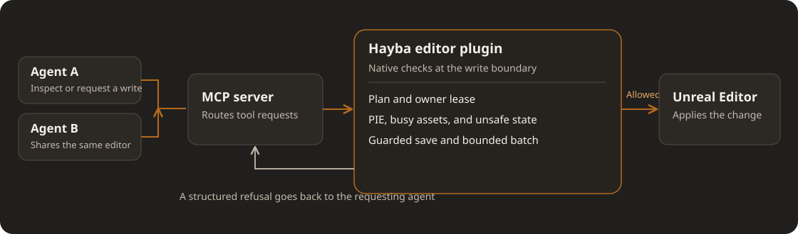

  
  <h1>Hayba</h1>
  
Inspect and edit Unreal Engine projects with an AI assistant.

  
<a href="https://github.com/zajalist/hayba/releases/tag/desktop-v0.1.0-preview.1"><strong>Download Desktop for Windows (preview)</strong></a> · <a href="https://github.com/zajalist/hayba/releases/tag/v0.4.2"><strong>Download the v0.4.2 plugin</strong></a> · <a href="INSTALL.md">Installation guide</a> · <a href="docs/wiki/">Tool reference</a>

## Get started

Use a closed Unreal Engine 5.9 project on Windows x64. The release bundles the native plugin, Node runtime, and MCP server.

1. Download **Plugin** for chat inside Unreal, or **Plugin+MCP** to also connect an external client such as Claude Code or Cursor. [Windows installers](https://github.com/zajalist/hayba/releases/tag/v0.4.2)
2. Run Setup and select the project’s `.uproject` file.
3. Open the project and choose **Tools → Hayba MCP Toolkit**. In Settings, select a provider and enter your API key. Windows encrypts the saved key for your user account.
4. Start with a read-only question such as “Which actors are in this level?” Review the result before asking for an edit.

**Known issue in v0.4.2.** In-editor chat can stay on “Responding…” when the bundled server fails to start. The Desktop preview includes fixes for server startup and repeated chat initialization. [Preview build instructions](https://github.com/zajalist/hayba/tree/feature/desktop-preview/desktop)

## How it works

The TypeScript MCP server translates tool calls into editor operations. The C++ plugin reads the current scene, checks editor state and ownership, and returns the result. For example, when two agents target the same asset, an editor lease lets the second agent see that the first one is still working. [Architecture](docs/ARCHITECTURE.md) · [Editor checks and approvals](docs/safety-model.md)

## Hayba Desktop preview

The Windows desktop app uses the Unreal chat interface and supports streaming conversations with an OpenAI or Anthropic API key. Desktop and Unreal currently keep separate conversations. Scene inspection and approved editor edits run in the plugin. [Preview source and build instructions](https://github.com/zajalist/hayba/tree/feature/desktop-preview/desktop)

Download **Hayba-Desktop-Setup.exe** from the [Windows Desktop preview](https://github.com/zajalist/hayba/releases/tag/desktop-v0.1.0-preview.1). Leave the project field blank for Desktop alone, or select a closed UE 5.9 project to install the editor panel. If the panel is missing after reopening the project, check **Edit → Plugins → Hayba MCP Toolkit** and restart Unreal after enabling it.

To remove Desktop and its project integration, close Hayba and Unreal, then select **Windows Settings → Apps → Installed apps → Hayba Desktop Preview → Uninstall**. Setup keeps a backup of removed plugin files in the project's `Saved/HaybaInstaller` folder.

## Explore the code

| Component | What lives there |
| --- | --- |
| [Unreal plugin](unreal/HaybaMCPToolkit/) | Chat workspace, native command handlers, and editor automation tests |
| [MCP server](mcp-tools/hayba-mcp/) | Tool schemas, provider clients, and request routing |
| [Architecture decisions](docs/adr/) | The design decisions behind coordination, permissions, and optional integrations |

[Release history](CHANGELOG.md) · [Contributing](CONTRIBUTING.md) · [Security](SECURITY.md) · [MIT license](LICENSE)
