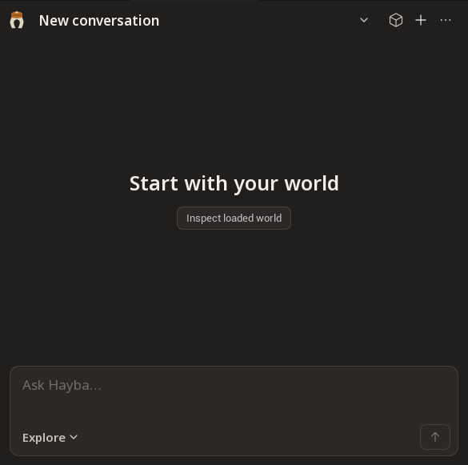
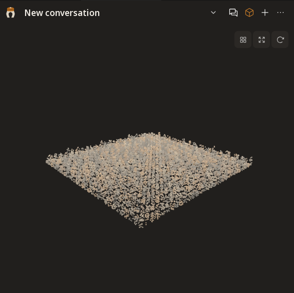
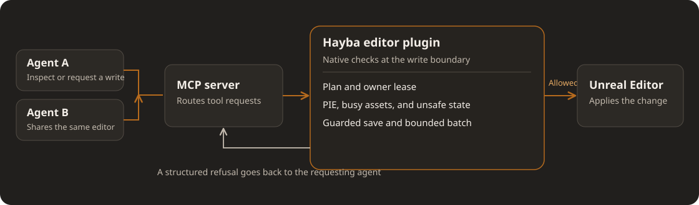

<div align="center">


# Hayba

**Build Unreal worlds with agents that can share an editor.**

Inspect, plan, build, and validate Unreal Engine worlds through MCP. Native editor checks keep agent work accountable to the state of the project.

**[Install Hayba 0.4.1 on Windows with Unreal Engine 5.9, step by step](INSTALL.md)**

[Explore the architecture](docs/ARCHITECTURE.md) | [Browse the tools](docs/wiki/) | [Changelog](CHANGELOG.md) | [Contribute](CONTRIBUTING.md)

</div>

Hayba connects MCP-capable agents to Unreal Editor. It gives them a wide tool library, a focused in-editor workspace, and a native safety boundary for changes to a shared project.

> **Release status:** `v0.4.1` is the latest release. It is tested on Unreal Engine 5.9 (5.7 and 5.8 may work but were not tested for this release) and ships the new editor workspace, multi-agent editor leases and the editor safety train. See the [changelog](CHANGELOG.md) and [versioning](docs/VERSIONING.md).

<table>
  <tr>
    <td width="50%"></td>
    <td width="50%"></td>
  </tr>
  <tr>
    <td><strong>Chat</strong><br />One place to ask, inspect, and follow a task.</td>
    <td><strong>World</strong><br />A scene-derived spatial view of the loaded meshes.</td>
  </tr>
</table>

*Actual scratch-editor captures of the editor workspace. Chat shows the empty workspace; it does not demonstrate a connected conversation. World shows 130,048 sampled points from 1,024 synthetic actors, not an entire unloaded project.*

## See the workflow

A typical request is concrete: *“Inspect this level, propose a route to the focal point, then make the approved changes.”* Hayba exposes the scene and relevant tools, lets the agent prepare a reviewable plan, and checks the editor before writes. [The install guide](INSTALL.md) walks through setup step by step.

## Why Hayba

| Strength | What it means in practice | Status |
| --- | --- | --- |
| **Tools for actual production work** | Actors, assets, levels, Blueprints, PCG, materials, UI, physics, animation, audio, tests, and project operations. Agents can discover signatures as needed instead of loading the whole catalog at once. | Available |
| **Shared-editor coordination** | Owner-bound leases and busy-asset rules turn competing writes into explicit refusals. Bounded batches stop when editor state changes. The orchestrator can respond instead of guessing what happened. | Available in `0.4.1` |
| **Native crash and state guards** | A contained native fault leaves the editor in a sticky unsafe state. Play, dirty Blueprints, read-only saves, and unattended execution receive checks at the editor boundary. | Available in `0.4.1` |
| **Reviewable changes** | Plan Mode can require approval before destructive steps. Supported operations use Unreal undo transactions; structured results expose refusals and partial work. | Available; expanded in `0.4.1` |
| **A scene-derived World view** | The development preview samples loaded meshes and first-visible depth. Agents can capture local geometry tiles on demand, page authored sources and provisional spatial relations, and inspect coverage gaps; most depth points remain unattributed. | Development branch |

The [tool reference](docs/wiki/) covers individual operations. Optional [GAS and MetaSound plugins](docs/adr/0008-satellite-plugins-earn-their-place.md) extend the core. The distinction is how the tools work together under a shared editor's live constraints.

## See the safety boundary



The [TypeScript MCP server](mcp-tools/hayba-mcp/) routes requests to the [C++ editor plugin](unreal/HaybaMCPToolkit/). The editor plugin checks state and ownership where writes actually happen. The [visual sidecar](mcp-tools/hayba-mcp/addons/visual-embeddings/) is optional. [Explore the architecture](docs/ARCHITECTURE.md).

## Safety is part of the workflow

Release `0.4.1` includes a coordinated set of protections: sticky refusal after a contained native fault, PIE and asset-busy checks, guarded save paths, owner-bound leases with recovery, and bounded batch execution. These address a shared editor's real failure modes: one agent can hold a resource while another reads stale state, Play can begin during a build, or a native fault can leave the editor unsafe for more writes. [The scratch-host safety guide](docs/SAFETY-scratch-host-and-leases.md) records the live verification boundaries.

Hayba does not treat every refusal as failure. A structured refusal tells the agent whether to wait, refresh state, request a lease, stop Play, or return control to the user. Plan Mode requires approval for destructive commands when enabled; owner-bound leases, PIE and editor-health guards apply independently. Native undo covers supported operations, with documented exceptions. [Read the safety model](docs/safety-model.md) · [Security policy](SECURITY.md) · [Decision records](docs/adr/)

## World, from scene evidence

The current preview progressively scans loaded static meshes. The scratch-editor capture above shows 130,048 surface samples from 1,024 synthetic actors, with source links for those mesh samples. A [second scratch capture](docs/media/world-depth-scratch-preview.png) includes 37,277 depth-derived points from a 256×256 capture of first-visible surfaces. A [zoom-local tile](docs/media/world-tile-scratch-preview.png) adds 8,192 points sampled from mesh triangles. An agent can start a loaded-world tile capture with `world_tile_capture`, then inspect its bounded geometry, source nodes, and authored semantic groups with `world_semantic_snapshot`. The latest depth observation also has queryable pages with a capture ID, camera, coverage, and gaps. Uncaptured regions report `not_captured`. The depth pass covers one editor-camera view, not an entire level; only sparse depth-matched collision labels identify possible sources. Unloaded cells and occluded surfaces remain unknown.

[Open the World capture](docs/media/world-mesh-splat-preview.png) · [Zoom-local mesh detail](docs/media/world-tile-scratch-preview.png) · [Read the World model](docs/world-intelligence.md)

## The next World layer

The next layer will use that evidence to compare scene composition and production options: sightlines, routes, streaming and NPC pressure, memory, texel density, PCG placement, and hand-placed focal assets. It should score alternatives with measured constraints and call out unknowns. **That decision layer is planned work, not a shipped capability.** [Read the World direction](docs/world-intelligence.md).

## Install

**Requirements:** Windows, Unreal Engine 5.9, Node.js 22.5 or newer, Git, and the Visual Studio C++ tools Unreal uses to compile plugins. The optional visual sidecar has separate Python dependencies.

**[Follow the step-by-step install guide](INSTALL.md).** It covers every click and command, how to check each part works, and a troubleshooting table. The short version, in PowerShell:

```powershell
git clone --branch v0.4.1 https://github.com/zajalist/hayba.git C:\Tools\hayba
Set-Location C:\Tools\hayba; npm install; npm run build
$Project = "C:\path\to\YourProject"   # the folder with your .uproject
New-Item -ItemType Directory -Force "$Project\Plugins"
New-Item -ItemType Junction -Path "$Project\Plugins\HaybaMCPToolkit" -Target "C:\Tools\hayba\unreal\HaybaMCPToolkit"
& "C:\Program Files\Epic Games\UE_5.9\Engine\Build\BatchFiles\Build.bat" UnrealEditor Win64 Development -Project="$((Get-ChildItem $Project -Filter *.uproject).FullName)" -WaitMutex
claude mcp add hayba-toolkit -- node C:\Tools\hayba\mcp-tools\hayba-mcp\dist\bootstrap.js
```

Then open the project. The **Hayba MCP Toolkit** panel opens by itself the first time (later: **Tools > Hayba MCP Toolkit**). Start with a scratch project while evaluating any tool that can modify editor state. [Getting started](docs/getting-started.md) covers add-ons and other MCP hosts.

## Explore the repository

| Area | Purpose |
| --- | --- |
| [`unreal/HaybaMCPToolkit`](unreal/HaybaMCPToolkit/) | Native editor integration and tool handlers |
| [`mcp-tools/hayba-mcp`](mcp-tools/hayba-mcp/) | MCP server, schemas, and tool routing |
| [`docs/wiki`](docs/wiki/) | Tool and workflow reference |
| [`docs/adr`](docs/adr/) | Architecture decisions |
| [`website`](website/) | Public Hayba site |

Developers can run `npm --prefix mcp-tools/hayba-mcp test` for the Node gate. Unreal tests require a separately built project; [CONTEXT.md](CONTEXT.md) and [the architecture guide](docs/ARCHITECTURE.md) explain the boundaries before changing them.

<div align="center">

**A worldbuilding tool should understand the world—and know when to stop.**

[Getting started](docs/getting-started.md) · [Changelog](CHANGELOG.md) · [License](LICENSE)

</div>
