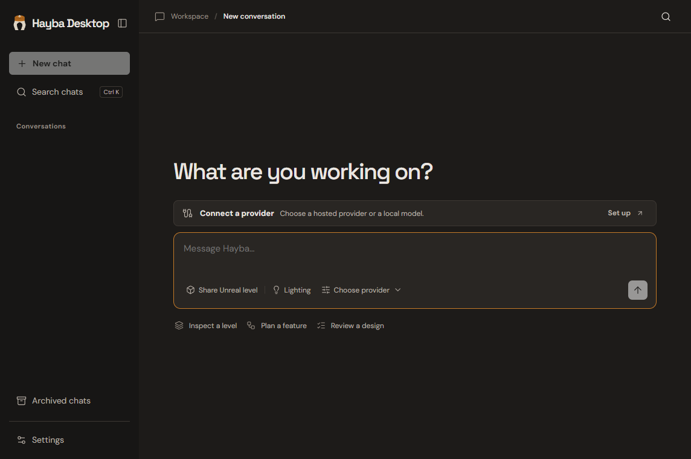
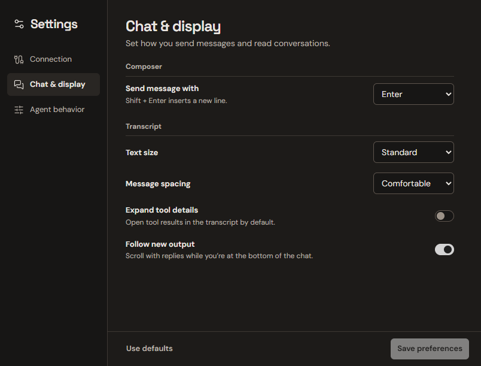
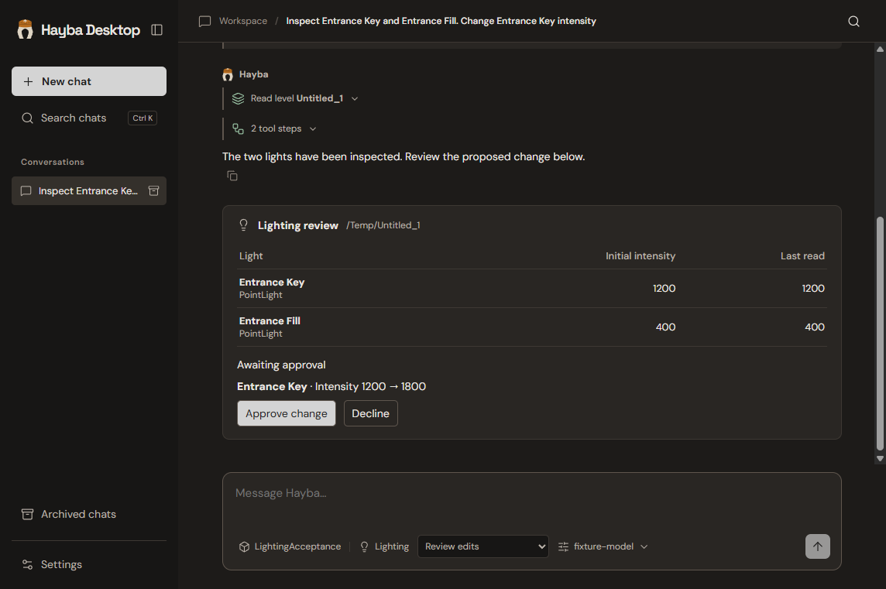

# Hayba Desktop for Windows



Install Hayba with `Hayba-Desktop-Setup.exe`. To add the chat panel to Unreal, close the editor and select your project's `.uproject` in the same wizard. You can also install Desktop on its own. The bundled editor plugin requires the Windows x64 Unreal build used to compile it.

Open **Settings → Connection** to select Anthropic, OpenAI, DeepSeek, Groq, OpenRouter, Ollama, LM Studio or a custom OpenAI-compatible endpoint. Enter a model ID offered by your provider. Custom endpoints accept HTTPS or HTTP on localhost. Local servers can run without a key. Windows protects any saved key with DPAPI and binds it to the selected provider and endpoint.

Use **Chat & display** to set the send shortcut, text size, spacing, automatic scrolling and tool details. **Agent behavior** includes custom instructions, an output token limit and a tool-call limit. Unreal’s editor preferences, including conflict handling and Plan Mode, are in the Hayba panel for each project.



**New chat** opens an empty composer. Conversations and drafts appear in the sidebar after they have content. Use the archive action beside a conversation to remove it from the active list. **Archived chats** lets you restore the transcript or unsent draft.

Press **Ctrl+K** to find a conversation. Select **Share Unreal level** in the composer and choose an open project. Hayba verifies the editor’s identity before sharing the map name, package path, actor count and play state with your provider. Expand **Read level** in the reply to see what the editor returned. Sharing applies to that conversation until you disconnect it or quit Desktop.

Select **Lighting** in the composer to inspect two loaded point, spot, rect or directional lights. Choose one, enter its new intensity and select **Review change**. With a provider connected, you can also ask in chat, for example “Inspect Entrance Key and Entrance Fill. Change Entrance Key intensity to 1800.”

**Decline** leaves both lights alone and reads them again. **Approve change** submits the exact edit over MCP. When the project uses Plan Mode, select **Approve operation** in Unreal’s Hayba panel. Desktop reads both intensities back and shows the observed values. **Undo intensity change** restores the original intensity after checking that both lights still match. Save the level in Unreal when you want the edit to persist.

The desktop and editor keep separate chat histories. The [desktop workflow comparison](agent-workflows.md) covers the remaining gaps.



For unattended lighting edits, attach the project and change **Review edits** to **Automatic · no approvals** in the composer. In Unreal, turn off **Plan Mode** in Hayba Settings → Preferences → External MCP safety for that project. Hayba remembers the desktop choice per project. Ask it to change one light, then say “Undo my last lighting edit.” Each operation appears in the conversation with the observed values. Switch back to **Review edits** whenever you want a preview.

With a project attached, the assistant streams its response, chains supported tools across multiple steps and shows the outcome of each step. You can stop a response and continue in the same conversation.

## Build on Windows x64

Install Node.js, the matching Unreal Engine and Inno Setup 6. From the repository root, run:

```powershell
npm ci
npm ci --prefix desktop
npm ci --prefix mcp-tools/hayba-mcp/dashboard
npm run build -w @hayba/mcp
& "$Engine/Engine/Build/BatchFiles/RunUAT.bat" BuildPlugin "-Plugin=$PWD/unreal/HaybaMCPToolkit/HaybaMCPToolkit.uplugin" "-Package=$PWD/desktop/bin/native" -TargetPlatforms=Win64 -NoTargetPlatforms -Rocket
node tools/build-installer.mjs --desktop --artifact desktop/bin/native --engine "$Engine" --output desktop/bin/setup
```

Set `$Engine` to your engine installation directory before running these commands. The output directory contains the setup executable and its SHA-256 checksum.

## Exercise the installed app and editor

Run `node desktop/smoke.cjs "path/to/installed/Hayba.exe"` to check the provider settings, encrypted key storage and a streaming reply with an offline fixture.

For the editor test, install the plugin in a disposable project, select the mock provider and mock model, and open its Hayba tab with Unreal launched with `-cefdebug=39783`. Run `node desktop/test-editor.cjs "path/to/project.uproject" 39783` to send a message and inspect the current scene.

For the lighting acceptance test, build the test-only `testing/LightingFixture` plugin for UE 5.9 and enable it in a disposable project named `LightingAcceptance`. Install Hayba into that project with Setup. Launch the editor with `-HaybaLightingFixture -ExecCmds="Hayba.MCP.Open"` and Plan Mode enabled. Run `node desktop/test-lighting.cjs "path/to/installed/Hayba.exe" "path/to/LightingAcceptance.uproject"`. The fixture creates two point lights, operates the editor’s visible review button and reads both actual component values independently of MCP. The provider response is deterministic. The fixture is excluded from the installer.

For automatic mode, repeat the lighting test with Plan Mode off in the disposable project and append `--automatic`. This sends two chat messages and checks both lights through the test plugin after each write.

To check cold startup, close the disposable editor and run `desktop/test-slow-editor.ps1 -Project <LightingAcceptance.uproject> -Editor <UnrealEditor.exe>`. The fixture delays the HTML chat script by 12 seconds, requires a provider reply and live level inspection, then restores the original script.
